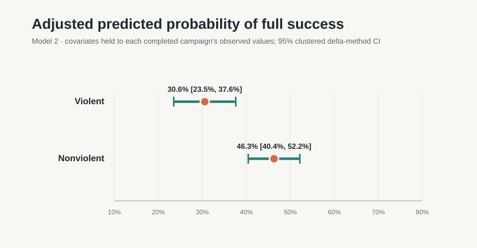

# Do Protests Actually Change Anything?

## 1. Research question

Are nonviolent campaigns associated with a higher probability of full success than violent campaigns, after accounting for campaign year, objective, and duration? This matters because resistance strategies are discussed as if their outcomes were comparable, even though campaigns differ in goals and historical context.

## 2. Main finding

Among completed campaigns, **51.4% (150/292) of nonviolent campaigns** achieved full success, compared with **26.3% (70/266) of violent campaigns**. The unadjusted difference was **25.1 percentage points** (95% CI: **17.3 to 32.9**).

In the adjusted logistic model, nonviolent strategy was associated with **2.05 times the odds** of full success (95% country-clustered CI: **1.29 to 3.25**). Standardized average predicted probabilities were **30.6%** for violent campaigns (95% CI: **23.5% to 37.6%**) and **46.3%** for nonviolent campaigns (95% CI: **40.4% to 52.2%**); their difference was **15.7 points** (95% CI: **5.7 to 25.7**).



These are associations in NAVCO 1.3, not estimates of a causal effect.

## 3. Robustness across models

All models use the same 557 campaigns and 160 country clusters. Intervals are 95% country-clustered intervals.

| Model | Specification | NONVIOL odds ratio (95% CI) |
| --- | --- | ---: |
| 1 | Strategy only | 2.94 (1.99–4.34) |
| 2 | Start year, objective, and log(1 + duration) | 2.05 (1.29–3.25) |
| 3 | Start year and objective; duration omitted | 2.15 (1.36–3.40) |

The estimate gets smaller after adjustment, but remains positive in all three specifications. Model 3 is close to Model 2, suggesting the association is not driven only by duration adjustment. An odds ratio compares odds, not probabilities: 2.05 does not mean twice the probability of success.

## 4. What this analysis cannot say

The data are observational, so this analysis cannot establish that nonviolent strategy causes success. Unmeasured campaign, regime, and historical differences may confound the estimates. NAVCO focuses on maximalist campaigns and may underrepresent smaller or early-suppressed movements, particularly nonviolent ones.

The outcome is full success as coded in NAVCO: achieving all stated goals within a year of peak activity, directly through campaign activity. Limited success is counted as not fully successful. Ongoing campaigns and campaigns with no outcome flag are excluded from the completed-campaign analysis. Country-clustered errors allow for within-country dependence in uncertainty estimates, but do not remove country-level confounding or make campaigns independent across time.

## 5. Analysis decisions

| Decision | Reason |
| --- | --- |
| Exclude 62 `ONGOING` campaigns | They were unresolved by the dataset cutoff and are also coded as failures; excluding them avoids treating ongoing cases as completed failures. |
| Exclude 2 rows with no outcome flag | Their success status is undefined in the source. |
| Do not deduplicate `NAVCOID` | Repeated identifiers refer to different campaign records; there are no exact duplicate rows. |
| Exclude 1 row with missing objective from all models | Objective is a model control; no value is imputed, and the shared model sample stays comparable. |
| Use `log(1 + DURATION)` | Duration is right-skewed; the transform avoids assuming a linear effect per raw year. |
| Fit Model 3 without duration | Duration may be affected by campaign strategy or progress, so omitting it checks sensitivity to possible overadjustment. |
| Cluster standard errors by `LOCATION` | This allows campaign scores within a country to be dependent; it is not equivalent to country fixed effects or full confounding control. |
| Implement logit and clustered sandwich covariance with NumPy | The project keeps dependencies small; coefficients were checked against R base `glm` on the same model data. |

The descriptive comparison uses 558 completed campaigns. Models use 557 after excluding the additional missing-objective row. The workbook has 622 rows, 164 distinct `LOCATION` values, and 18 repeated `NAVCOID` values across 37 rows; repeated IDs are retained.

## 6. Reproduce

Tested with Python **3.12.14**, NumPy **2.5.4**, pandas **2.3.3**, and openpyxl **3.1.5**. From the repository root:

```bash
python3.12 -m venv .venv
source .venv/bin/activate
python -m pip install -r requirements.txt
python src/analyze.py
```

Place the source workbook at `data/NAVCO_1_3_List.xlsx`. The script resolves input and output paths relative to `src/analyze.py`, so it also works when invoked from another working directory. It regenerates the CSV and JSON summaries and SVG figures in `outputs/`. On the verification machine, a full run took about **4 seconds**.

## 7. Repository layout

```text
.
├── .gitignore                  # Python caches, local environments, OS files
├── LICENSE                     # MIT for project code; data terms are separate
├── README.md                   # Research summary and reproduction instructions
├── requirements.txt            # Runtime dependencies
├── data/
│   └── NAVCO_1_3_List.xlsx     # Source workbook
├── src/
│   └── analyze.py              # Cleaning, analysis, model, and chart pipeline
└── outputs/
    ├── *.csv                   # Data checks, descriptive and model tables
    ├── *.json                  # Machine-readable results and diagnostics
    └── *.svg                   # EDA and adjusted-probability figures
```

## 8. Possible next analyses

- Fit a mixed-effects logistic model with a country random intercept and compare it with the clustered model.
- Test alternative outcome definitions, including full-or-limited success and a three-category outcome.
- Estimate strategy associations by decade to examine temporal heterogeneity.
- Run sensitivity analyses for missing outcomes and objective coding, with each alternative sample and estimand reported explicitly.

## 9. Data and credits

Chenoweth, Erica, and Christopher Wiley Shay. **List of Campaigns in NAVCO 1.3.** Harvard Dataverse. [Dataset DOI: 10.7910/DVN/ON9XND](https://doi.org/10.7910/DVN/ON9XND). See the [NAVCO 1.3 codebook](https://dataverse.harvard.edu/file.xhtml?persistentId=doi:10.7910/DVN/ON9XND/PTMCCV) for variable definitions and coding rules.

Project code is licensed under the [MIT License](LICENSE). The dataset is separate from that license; the Harvard Dataverse record lists it under **CC0 1.0**. Consult the Dataverse record for the authoritative data terms.
